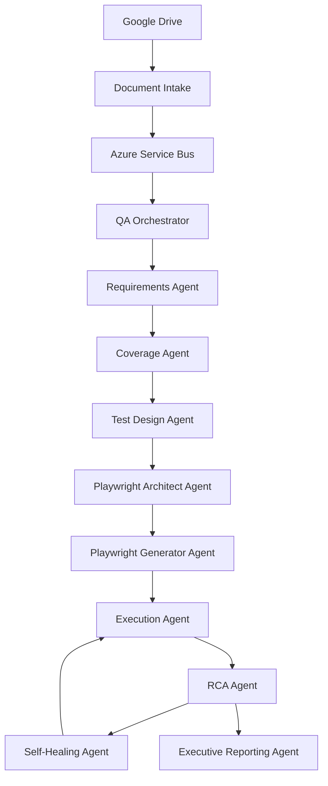

# Product Agentic QA Platform v3.0

## Evolution to Autonomous Product Testing Platform (APTP)

Este documento actualiza el plan anterior manteniendo toda la arquitectura de Product QA basada en documentación funcional y agregando una nueva capacidad:

> Generación autónoma, implementación, ejecución, análisis y autocorrección de pruebas E2E mediante Playwright.

---

# 1. Nueva Visión

## v2.0

```text
Documents
 ↓
Requirements Analysis
 ↓
Test Design
 ↓
Reports
```

---

## v3.0

```text
Documents
 ↓
Requirements Analysis
 ↓
Test Design
 ↓
Playwright Generation
 ↓
Autonomous Execution
 ↓
Failure Analysis
 ↓
Self-Healing
 ↓
Executive Reporting
```

---

# Objetivo

Permitir que el sistema:

* Entienda requerimientos.
* Diseñe pruebas funcionales.
* Genere código Playwright.
* Cree proyectos de automatización completos.
* Ejecute pruebas.
* Analice fallos.
* Genere RCA.
* Repare pruebas cuando sea posible.
* Genere evidencia y reportes ejecutivos.

---

# 2. Nuevo Posicionamiento

La plataforma deja de ser:

```text
Agentic Product QA Platform
```

y evoluciona hacia:

```text
Autonomous Product Testing Platform
```

---

# Capacidades principales

### Functional Intelligence

Comprensión de requerimientos.

### Test Intelligence

Diseño automático de pruebas.

### Execution Intelligence

Ejecución autónoma.

### Failure Intelligence

Análisis RCA.

### Self-Healing Intelligence

Corrección automática de automatizaciones.

### Reporting Intelligence

Generación de informes.

---

# 3. Arquitectura Actualizada



---

# 4. Nuevos Dominios Funcionales

Se agregan tres dominios.

## Test Automation Domain

Responsable de:

* creación de suites
* generación de código
* mantenimiento de automatizaciones

---

## Test Execution Domain

Responsable de:

* ejecución
* reintentos
* captura de evidencias

---

## Test Intelligence Domain

Responsable de:

* RCA
* healing
* optimización

---

# 5. Nuevos Agentes

---

# Agent 8 — Playwright Test Architect

## Objetivo

Convertir requerimientos en arquitectura de automatización.

---

## Entrada

```text
User Stories
Use Cases
Acceptance Criteria
```

---

## Salida

```json
{
  "suite":"Contact",
  "scenarios":[
    "valid submission",
    "required fields",
    "invalid email",
    "mobile layout"
  ]
}
```

---

## Responsabilidades

Generar:

* test suites
* escenarios
* prioridades
* agrupaciones funcionales

---

# Agent 9 — Playwright Code Generator

## Objetivo

Generar proyecto Playwright completo.

---

## Genera

```text
playwright-project/

package.json

playwright.config.ts

tests/

pages/

fixtures/

data/

reports/
```

---

## Patrón obligatorio

Page Object Model (POM)

---

## Nunca generar

```text
Selectors hardcoded everywhere
```

---

## Siempre generar

```text
Pages
Components
Fixtures
Utilities
```

---

# Agent 10 — Execution Agent

## Objetivo

Ejecutar pruebas.

---

## Actividades

Instalar dependencias.

```bash
npm install
```

---

Instalar navegadores.

```bash
npx playwright install
```

---

Ejecutar.

```bash
npx playwright test
```

---

Recolectar:

* screenshots
* traces
* videos
* logs

---

# Agent 11 — Failure RCA Agent

## Objetivo

Determinar por qué falla una prueba.

---

## Analiza

### Playwright traces

```text
trace.zip
```

### Screenshots

```text
failure.png
```

### Console logs

### Network logs

### DOM snapshots

---

## Produce

```json
{
  "root_cause":"Selector changed",
  "confidence":0.93
}
```

---

# Agent 12 — Self-Healing Agent

## Objetivo

Corregir automatizaciones.

---

## Casos

### Selector drift

Antes

```typescript
#submit-btn
```

Después

```typescript
[data-testid="submit"]
```

---

### Texto cambiado

Antes

```text
Submit
```

Después

```text
Send Message
```

---

### Componentes movidos

Actualización automática.

---

## Restricción

Nunca modificar lógica funcional.

Solo:

* selectores
* localizadores
* waits
* sincronización

---

# 6. Repositorio de Automatización

NO almacenar pruebas generadas dentro del repositorio principal.

---

## Estrategia

Crear repositorios dedicados.

Ejemplo:

```text
generated-tests/

portfolio-site/

banking-app/

mobile-app/
```

---

## Alternativa

Monorepo.

```text
generated-test-projects/

project-a/

project-b/

project-c/
```

---

# 7. Playwright Standards

## Framework

Playwright

---

## Lenguaje

TypeScript

---

## Patrón

Page Object Model

---

## Naming

```text
home.spec.ts

contact.spec.ts

projects.spec.ts
```

---

## Reportes

HTML

JSON

JUnit

---

# 8. Ejecución Autónoma

## Nivel 1

Generate

Execute

Report

---

## Nivel 2

Generate

Execute

Analyze

Report

---

## Nivel 3

Generate

Execute

Analyze

Heal

Re-execute

Report

---

## PoC Target

Nivel 3

---

# 9. Artefactos Generados

Por ejecución.

---

## Código

```text
tests/

pages/

fixtures/
```

---

## Evidencia

```text
screenshots/

videos/

traces/
```

---

## RCA

```json
{
  "root_cause":"",
  "confidence":0.0
}
```

---

## Reportes

PDF

HTML

Markdown

---

# 10. Memoria Actualizada

Redis sigue igual.

---

## Nuevo namespace

```text
execution:{id}:test_plan

execution:{id}:generated_code

execution:{id}:execution_results

execution:{id}:rca

execution:{id}:healing
```

---

# 11. Nuevos Eventos

Agregar:

```text
TEST_PLAN_CREATED

PLAYWRIGHT_GENERATED

EXECUTION_STARTED

EXECUTION_COMPLETED

TEST_FAILED

RCA_COMPLETED

HEALING_STARTED

HEALING_COMPLETED

REEXECUTION_COMPLETED
```

---

# 12. Base de Datos

Agregar tablas.

---

## test_suites

```text
suite_id
project_id
feature
```

---

## generated_tests

```text
test_id
suite_id
file_path
```

---

## execution_runs

```text
run_id
status
duration
```

---

## rca_reports

```text
report_id
root_cause
confidence
```

---

## healing_actions

```text
action_id
test_id
change_applied
```

---

# 13. Reporting Actualizado

---

## QA Report

Cobertura.

---

## Automation Report

Suites generadas.

Pruebas ejecutadas.

Pass rate.

---

## RCA Report

Hipótesis.

Confidence score.

---

## Healing Report

Correcciones aplicadas.

---

## Executive Report

Release readiness.

Coverage.

Automation maturity.

Risk score.

---

# 14. Nuevas Métricas

## Product QA

Coverage %

Requirement Quality

Traceability %

---

## Automation

Tests Generated

Tests Executed

Pass Rate

Flaky Rate

---

## RCA

Accuracy

Confidence

Recurring Failures

---

## Self-Healing

Healing Success %

Automatic Recovery %

Manual Intervention %

---

# 15. Fases de Implementación

## Fase 1

Document Intake

Requirements Analysis

Coverage

Traceability

Reporting

---

## Fase 2

Playwright Architect

Code Generation

Project Generation

---

## Fase 3

Execution Engine

Artifact Collection

HTML Reports

---

## Fase 4

RCA Engine

Trace Analysis

Failure Categorization

---

## Fase 5

Self-Healing

Autonomous Re-execution

Continuous Learning

---

# Resultado Final

La solución deja de ser únicamente un motor de análisis documental y se convierte en una **Autonomous Product Testing Platform** capaz de:

1. Ingerir documentación funcional desde Google Drive.
2. Construir conocimiento estructurado del producto.
3. Diseñar automáticamente escenarios de prueba.
4. Generar proyectos Playwright completos en TypeScript.
5. Ejecutar pruebas E2E de forma autónoma.
6. Analizar fallos mediante RCA especializado.
7. Aplicar self-healing cuando sea viable.
8. Reejecutar validaciones.
9. Generar evidencia técnica y ejecutiva.
10. Mantener trazabilidad completa desde Requirement → Test Case → Execution → Evidence → Report.
